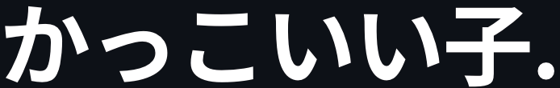

  

<h3 align="center">Hi! i'm kadet</h3>

$$
\large\color{#9198a1}{\begin{array}{c}
\textsf{I plan, design, build and maintain software. These days, that} \\
\textsf{mostly involves teaming up with agents on anything from interfaces} \\
\textsf{that feel alive to the cloud pipelines that keep them running.}
\end{array}}
$$

$$
\large\color{#9198a1}{\begin{array}{c}
\textsf{Over the years, I've worked mostly in product and design} \\
\textsf{engineering, across gaming, finance and creative development.} \\
\textsf{Right now, I'm solving problems for recruiting teams.}
\end{array}}
$$

 

  <a href="https://kadet.dev"> kadet.dev</a> &nbsp;·&nbsp;
  <a href="https://kadetxx.substack.com"> Substack</a> &nbsp;·&nbsp;
  <a href="mailto:hello@kadet.dev"> hello@kadet.dev</a>

